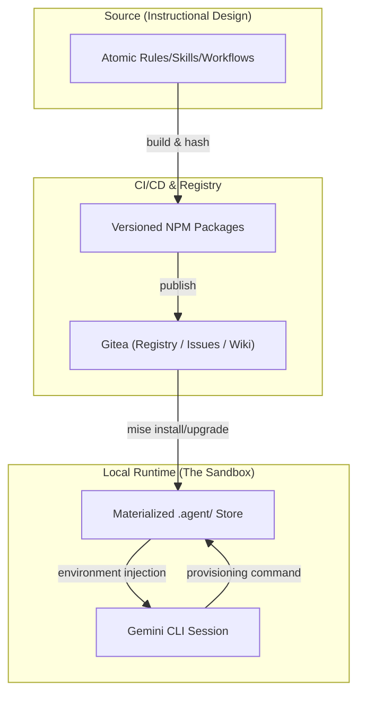

# The `gno` Agentic Infrastructure Development Kit


> **Implementing Deterministic State Management and Versioned Instruction Provisioning for Generative Agents.**


---

## 🏗️ Architecture

This repository provides a framework for managing **Agentic Intelligence as a Distributed Configuration System**. It treats agent constraints—Rules, Skills, and Workflows—as immutable, versioned, and programmatically provisioned infrastructure.

The system connects static instructional definitions with a live agent runtime, ensuring that interaction is governed by a deterministic and reproducible state.

### Core Concepts
*   **Atomic Instruction Packaging**: Logic components are standalone, versioned NPM packages, enabling granular dependency management and lifecycle control.
*   **Deterministic Provisioning**: Uses `mise` as an execution engine to atomically materialize agent environments from a private, **open-source Gitea-hosted registry**.
*   **Conversational Orchestration**: A specialized Gemini CLI Extension that facilitates real-time role provisioning and state-switching mid-session.
*   **Ecosystem Integration**: Integrated with **Gitea Issue Tracking and Wiki systems**, providing a unified substrate for agentic task execution, knowledge management, and auditability.
*   **Environment-Aware Distribution**: Automated OS and architectural filtering via standard Node.js metadata and custom deployment hooks.

---

## 🚀 Usage

The GNOMATIX ecosystem integrates into existing engineering workflows.

### 1. Initialization
Agents are provisioned using high-level roles that encapsulate all necessary behavioral constraints:

```bash
/role agent-default
```

This command initiates an atomic pull-extract-materialize cycle, handled by the custom `mise` backend, provisioning the agent's operating environment.

### 2. State Mapping
Workspace states are encoded in `mise.toml`, providing an audit trail and lockfile for the agent's active instructional set.

---

## 🧬 Infrastructure Components

| Layer | Function | Implementation |
| :--- | :--- | :--- |
| **Rules** ⚖️ | Behavioral Constraints | Immutable Markdown definitions versioned as atomic packages. |
| **Skills** 🛠️ | Capability Extensions | Programmatic interfaces and tool-calling specifications. |
| **Workflows** 🔄 | Procedural Logic | Step-by-step operational procedures for complex task execution. |
| **Roles** 📦 | Composite Archetypes | Curated bundles defining a specific agent mission or persona. |

---



---

## 🛠️ Contribution & Development

This repository serves as an iterative sandbox for the development of agentic infrastructure.

*   [**Architectural Deep Dive**](./docs/ARCHITECTURAL_OVERVIEW.md)
*   [**Development Workflows**](./docs/developer/README.md)
*   [**Versioning Policy**](./docs/developer/VERSIONING.md)

---

## ⚖️ License
BSL-1.1 © [Brett Whitty](mailto:brett@gnomatix.com)
